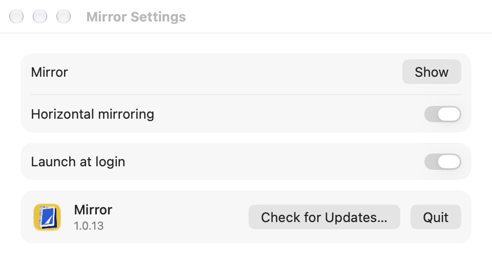

# Mirror

<p align="center"></p>

A native macOS camera mirror with a floating, resizable preview and a menu bar entry.

[简体中文](README.zh-CN.md)

## Install

Requires macOS 14 or later. Download and open the signed, notarized installer:

```bash
curl -fL https://github.com/x0c/Mirror/releases/latest/download/Mirror.dmg -o /tmp/Mirror.dmg && open /tmp/Mirror.dmg
```

Drag Mirror into Applications. Updates are delivered through the signed in-app updater.

## Use

1. Launch Mirror. It stays in the menu bar; startup never opens the camera.
2. Left-click its menu bar icon to show or hide the mirror. Grant Camera access when prompted.
3. Right-click for settings, horizontal mirroring, login startup, updates and quit.
4. Drag the preview to move it; drag its edges or corners to resize.

Window position, size, opacity and mirroring preferences are remembered locally.

## Settings



## Build

Requires Xcode 26 or later and [XcodeGen](https://github.com/yonaskolb/XcodeGen).

```bash
git clone https://github.com/x0c/Mirror.git
cd Mirror
xcodegen generate
xcodebuild -project Mirror.xcodeproj -scheme Mirror -configuration Debug build
```

## Privacy

Camera frames and preferences stay on this Mac. The app connects to the public distribution service only to check for and download updates; it does not upload camera frames or preferences.

## License

MIT — see [LICENSE](LICENSE).
